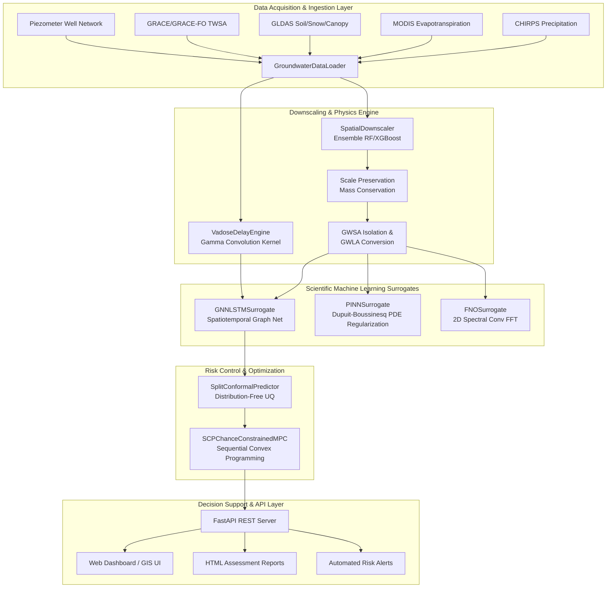
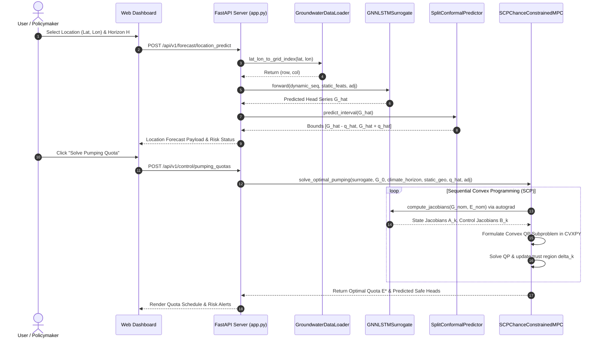

# System Architecture & Class Diagrams

**Project**: Satellite-Enhanced Groundwater Level Prediction and Sustainable Extraction Modeling System  
**Date**: August 2026  

---

## 1. High-Level System Architecture Diagram



---

## 2. Comprehensive UML Class Diagram

```mermaid
classDiagram
    class BaseDataProvider {
        <<abstract>>
        +get_grid_metadata() Dict
        +fetch_hydroclimate_rasters(timesteps) Dict
        +fetch_piezometer_observations(num_wells, timesteps) Dict
        +fetch_static_geophysics() Dict
    }

    class SyntheticDataProvider {
        +grid_shape: Tuple
        +mascon_grid_shape: Tuple
        +region_key: str
        +bounds: List
        +get_grid_metadata() Dict
        +fetch_hydroclimate_rasters(timesteps) Dict
        +fetch_piezometer_observations(num_wells, timesteps) Dict
        +fetch_static_geophysics() Dict
    }

    class RealtimeEarthEngineDataProvider {
        +ee_project_id: str
        +ee_initialized: bool
        +get_grid_metadata() Dict
        +fetch_hydroclimate_rasters(timesteps) Dict
    }

    class GroundwaterDataLoader {
        +data_mode: str
        +grid_shape: Tuple
        +provider: BaseDataProvider
        +set_data_mode(mode)
        +set_region(region_key, bounds)
        +load_processed_dataset(timesteps, num_wells) Dict
        +lat_lon_to_grid_index(lat, lon) Tuple
        +grid_index_to_lat_lon(row, col) Tuple
    }

    class SpatialDownscaler {
        +model_type: str
        +n_estimators: int
        +model: Regressor
        +fit_and_downscale(rasters, geophysics, mascon_grid_shape) Dict
    }

    class VadoseDelayEngine {
        +alpha_lag: float
        +beta_lag: float
        +compute_gamma_kernel(max_lag) ndarray
        +compute_effective_recharge(P, ET, Qs) ndarray
    }

    class GraphConvLayer {
        +linear_self: nn.Linear
        +linear_neigh: nn.Linear
        +forward(x, adj) Tensor
    }

    class GNNLSTMSurrogate {
        +num_wells: int
        +gnn_layers: ModuleList
        +lstm: LSTMCell
        +head_pred: nn.Linear
        +compute_adjacency(coords, radius) Tensor
        +forward(dynamic_seq, static_feats, adj) Tensor
    }

    class PINNSurrogate {
        +net: Sequential
        +forward(coords_t) Tensor
        +compute_pde_residual(coords_t, Sy, K) Tensor
        +compute_composite_loss(obs_coords_t, obs_h, colloc_coords_t) Tuple
    }

    class SpectralConv2d {
        +modes1: int
        +modes2: int
        +weights1: Parameter
        +weights2: Parameter
        +forward(x) Tensor
    }

    class FNOSurrogate {
        +conv0: SpectralConv2d
        +conv1: SpectralConv2d
        +conv2: SpectralConv2d
        +w0: Conv2d
        +w1: Conv2d
        +w2: Conv2d
        +forward(x) Tensor
    }

    class SplitConformalPredictor {
        +alpha: float
        +q_hat: float
        +calibrate(y_true, y_pred) float
        +get_safety_threshold(h_min) float
        +predict_interval(y_pred) Tuple
        +evaluate_coverage(y_test, y_pred_test) Dict
    }

    class SCPChanceConstrainedMPC {
        +horizon: int
        +num_wells: int
        +h_min: float
        +compute_jacobians(surrogate, G_k, E_k, climate_vec, static_geo, adj) Tuple
        +solve_optimal_pumping(surrogate, G_0, climate_horizon, static_geo, q_hat, adj) Dict
    }

    class FrameworkEvaluator {
        +compute_metrics(y_true, y_pred, h_min) Dict
        +run_feature_ablation_matrix(dataset, downscaler_results, Reff) Dict
        +run_spatial_kfold_cv(dataset, k_folds) Dict
    }

    BaseDataProvider <|-- SyntheticDataProvider
    BaseDataProvider <|-- RealtimeEarthEngineDataProvider
    GroundwaterDataLoader o-- BaseDataProvider
    GNNLSTMSurrogate *-- GraphConvLayer
    FNOSurrogate *-- SpectralConv2d
    SCPChanceConstrainedMPC ..> GNNLSTMSurrogate : autograd Jacobians
    SCPChanceConstrainedMPC ..> SplitConformalPredictor : safety bound
```



---

## 3. Data Flow Diagram (DFD - Level 1)

```
[Satellite Data (GRACE, CHIRPS, MODIS)] ───► (1. Data Ingestion & Spline Interpolation)
                                                            │
                                                            ▼
                                                [Normalized Rasters & Wells]
                                                            │
                                                            ▼
                                                (2. Spatial Downscaling & Vadose Delay)
                                                            │
                                                            ▼
                                                [GWLA Rasters & Effective Recharge R_eff]
                                                            │
                                                            ▼
                                                (3. Dynamic Surrogates: GNN / PINN / FNO)
                                                            │
                                                            ▼
                                                [Forecast Hydraulic Heads G_{t+1}]
                                                            │
                                                            ▼
                                                (4. Split Conformal UQ Calibration)
                                                            │
                                                            ▼
                                                [Empirical Error Margin q_hat]
                                                            │
                                                            ▼
                                                (5. SCP CCMPC Pumping Optimizer)
                                                            │
                                                            ▼
                                                [Optimal Pumping Quotas E_{1:H}*]
                                                            │
                                                            ▼
                                                (6. FastAPI Dashboard & HTML Reports)
```

---

## 4. Sequence Diagram: Real-Time Location Query & SCP Control Loop


